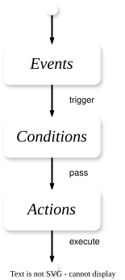
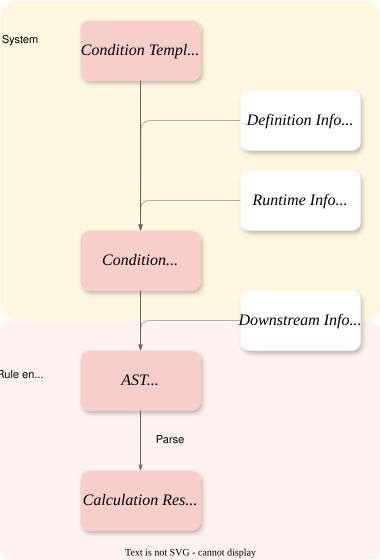
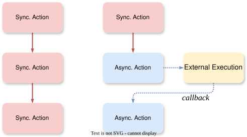
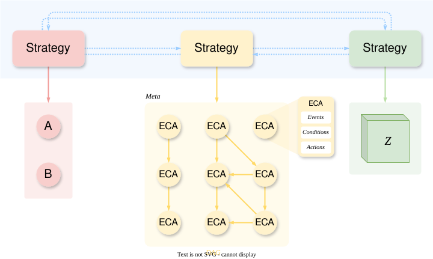
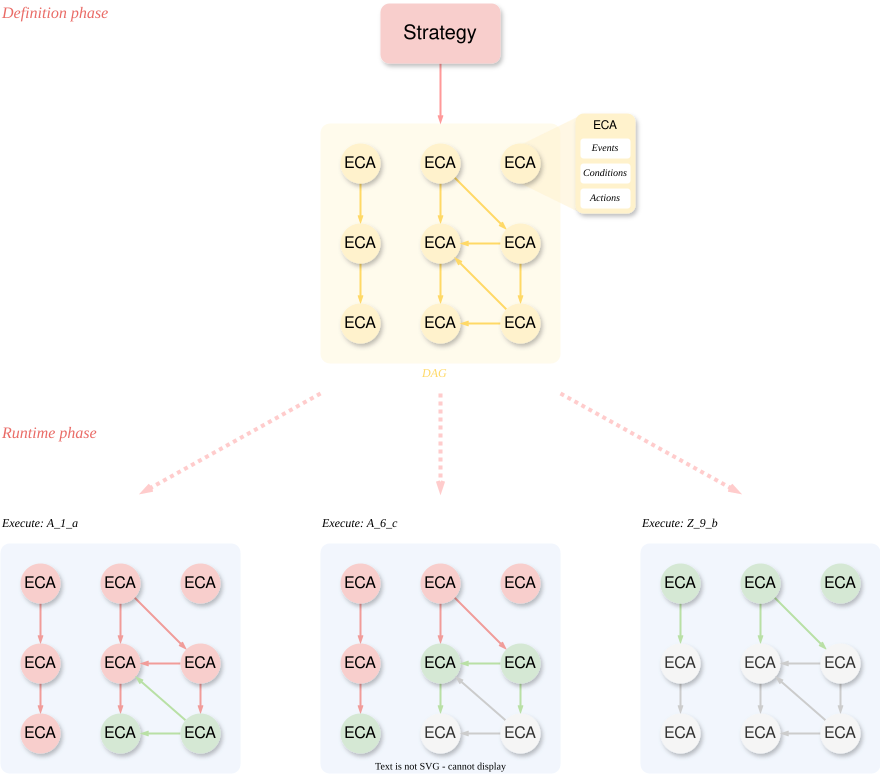
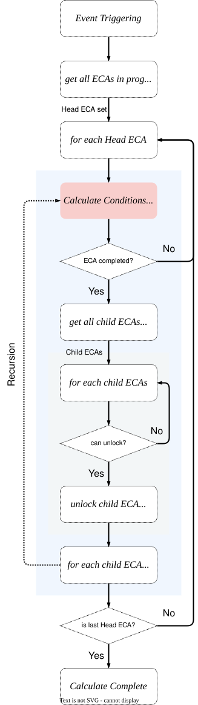

# Event-driven model: Event-Condition-Action

[TOC]

## ECA Basic Model

> **WHEN**  <*event*>  **IF**  <*condition*>  **THEN**  <*action*>.

The **event-driven model** is an architectural paradigm in which events determine the execution flow of a system. In this model, the system’s behavior revolves around event generation, detection, dispatch, and handling, thereby enabling a highly decoupled, asynchronous, and reactive system design.

- **Events**: A detectable occurrence, which carries the attributes and type of the event, and defines specific events or signals that can cause a change in the system state or require a system response. It is the starting point of the entire model’s execution and may originate from external inputs (such as user clicks), internal state changes (such as data updates, scheduled task triggered).
- **Conditions**: After the event is triggered, conditions consist of the logical rules that determine whether and how subsequent actions are executed.
- **Actions**: Actions are the concrete operations executed when an event is triggered and its conditions are satisfied, including updating data, invoking services, granting rewards, sending messages, or triggering new events.



### Events Triggering

#### Attributes

**Attributes** are the specific data fields attached to a business event. They provide contextual business information—such as user, order, or payment details—that can be used for business logic and processing, rather than serving merely as a notification.

**Which Events can be combined with which Conditions and Actions?** Each Event provides a set of attributes carrying specific business information (e.g., user ID, order amount). Conditions and Actions declare the attributes they require for execution (e.g., “grant reward” requires user ID). The system automatically determines whether a combination is valid and executable by checking whether the attributes provided by the Event satisfy the requirements of the Condition and Action.

**Consistency issues in data dependencies between Events and Conditions**. An Event may indicate the occurrence of a “local event” within the system, whereas Condition evaluation requires the “global state to be ready.” At the moment the Event is triggered, other related data required for subsequent condition evaluation may not yet have been generated, persisted, or may still be in an inconsistent intermediate state. Because different system components process data at different speeds, a time gap emerges between cross-component state consistency and the requirements of business logic. Therefore, the system should identify the true business moment at which “all required data are ready and consistent,” and to use that moment as a reliable triggering signal.

#### Runtime Events

**Runtime Events** are special events that represent important internal runtime state changes within an ECA Graph, such as node completion, dependency satisfaction, branch selection, or asynchronous callbacks. By representing these important transitions as explicit events, the runtime can handle graph progression using the same event-driven mechanism as external business events, rather than embedding such behavior as implicit scheduler logic.

| Special Event           | Triggered When                                               | Typical Use Case                                             |
| ----------------------- | ------------------------------------------------------------ | ------------------------------------------------------------ |
| Graph Instantiated    | A ECA Graph is instantiated into a runtime execution instance. | Initialize graph context, create node instances, assign idempotency keys. |
| Graph Started         | A graph instance begins execution.                           | Start source ECAs or compute the initial frontier node set.  |
| Graph Completed       | All required paths in the graph instance are completed, skipped, or invalidated according to graph completion policy. | Emit final strategy result, persist execution summary, notify downstream systems. |
| Graph Failed          | The graph can no longer proceed due to unrecoverable node failure, timeout, or policy violation. | Trigger alerting, manual intervention, compensation, or failure reporting. |
| Node Ready            | A node’s upstream dependency conditions are satisfied.       | Enable a successor node after all required parent nodes are completed. |
| Node Started          | A ready node is selected for execution.                      | Track node execution lifecycle and prevent duplicate execution. |
| Node Completed        | A node successfully finishes its condition evaluation and action execution. | Automatically activate successor nodes after a predecessor node completes. |
| Node Skipped          | A node is intentionally skipped because its condition is not satisfied or its branch is not selected. | Continue graph execution when a node is optional or conditionally bypassed. |
| Node Failed           | A node fails during condition evaluation or action execution. | Handle rule evaluation errors, action failures, or external service errors. |
| Node Timed Out        | A node or its asynchronous action does not complete within the configured timeout. | Trigger retry, mark failure, or continue with fallback logic. |
| Dependency Satisfied  | The required parent-node transition condition is satisfied.  | Decouple dependency calculation from actual node execution.  |
| Callback Received      | An external system sends a callback for a previously submitted asynchronous action. | Continue graph execution after payment confirmation, reward issuance, or third-party approval. |
| Retry Scheduled        | A failed or timed-out node/action is scheduled for another attempt. | Handle transient failures without immediately failing the graph. |
| Compensation Requested | A completed side effect must be reversed because a later step failed. | Support Saga-like rollback semantics.                        |


### Conditions Evaluation

**Conditions** are the decision-making component of an ECA, determining whether an action is eligible to run. In a configurable strategy system, conditions are usually expressed as a structured rule expressions or a domain-specific language (DSL), allowing business rules to be configured and executed dynamically without modifying application code.

At the most basic level, a condition describes a predicate over event attributes, runtime context, and business state. A condition expression is usually composed of several fundamental elements:

1. **Operands.** Operands are the values participating in the condition expression. They may come from event attributes, graph context, entity state, external systems, or static configuration.
2. **Operators.** Operators define how operands are compared or combined.
3. **Logical Connectors.** Multiple predicates can be combined into a compound condition using logical connectors.
4. **Functions.** A condition DSL may also support built-in or custom functions for common business logic. Functions should be carefully controlled because they may introduce external dependencies, non-deterministic behavior, or performance costs.
5. **Aggregations.** Some conditions require aggregation over a collection or time window. Aggregation conditions are more complex than simple predicates because they depend on historical data, time windows, and consistency guarantees.
6. **Quantifiers.** For collection-based data, the DSL may support quantifiers such as `any`, `all`, or `none`. These allow the condition system to express rules over lists, sets, and related entities.

**Atomic vs. Composite.** An **atomic condition** is the smallest independently evaluable predicate. A **composite condition** is composed of multiple atomic conditions connected by logical operators. This distinction is important because the rule engine may evaluate, trace, optimize, or short-circuit each atomic condition independently.

#### Condition Lifecycle

The full lifecycle from rule-template configuration to final resolution of rules is a process of progressively aggregating information and refining conditions.

1. **Condition Template**. A condition begins as a reusable template that defines the rule’s logical structure, required inputs, supported operators, and configurable parameters. At this stage, the condition remains abstract. It does not yet contain concrete parameter values, event data, or runtime state required for evaluation.

2. **Definition configuration injection.** During ECA configuration, the condition template is bound to strategy-specific values to produce a concrete rule.

3. **Runtime context injection.** When an event triggers the ECA, the system builds the evaluation context required by the condition, including event attributes,  graph context, and data obtained from external sources.
4. **Expression Compilation.** The complete condition is converted into an executable representation understood by the rule engine, such as abstract syntax tree and symbol tables. Simultaneously, the compiler queries to the built-in or three-party data sources to populate the symbol tables based on the pre-defined agreement.
5. **Condition Evaluation.** The rule engine evaluates the compiled condition against the resolved context and produces an evaluation result. The outcome is typically a boolean decision together with structured evaluation metadata, explaining how the decision was reached, making the ECA behavior observable, traceable, and explainable.
6. **Result Propagation.** The evaluation result is written back to the graph context, allowing downstream ECA nodes to consume it during their own condition evaluation. This makes condition evaluation not merely a local boolean check, instead of a coordinated graph-level execution control.



### Action Execution

Once an ECA condition is satisfied, the runtime executes the Action phase, where action represents the required business operations. If multiple actions exist, their execution strategy depends on the relationships and dependencies between them, typically using one of several execution modes.

- **Sequential Execution**: Actions run in order when later actions depend on earlier ones.
- **Parallel Execution**: Independent actions run concurrently, with the node waiting for all required actions to finish.
- **DAG-based Execution**: Actions follow a dependency graph, allowing sequential and parallel execution to be combined efficiently.


In sequential execution, actions can be:

- **Synchronous Action**: Completes immediately within the current execution context, so the runtime can save the result, update node status, and continue downstream processing.
- **Asynchronous Action**: Is submitted but completes later. The ECA Node enters a waiting state and resumes only after a correlated completion event, callback, or timeout is received.



**Idempotency.** Ensures the same logical action is executed only once for a given business context. Duplicate events, retries, or callbacks return the previously stored result instead of repeating the side effect.

**Output Propagation.** Action outputs are stored in the node or graph execution context and can be consumed by later actions, downstream nodes, condition evaluations, or generated events.

**Callback and Correlation.** Asynchronous actions use correlation identifiers to match external completion signals to the correct graph, node, and action. The runtime validates and deduplicates callbacks, persists results, updates state, and resumes execution safely.

#### Failure Handling

Action failures should be handled according to explicit failure policies. Common policies include:

- **Retry**: The action is retried according to a configured retry strategy, such as fixed interval, exponential backoff, or maximum retry count.
- **Skip**: The action is skipped when failure is acceptable and does not block the ECA node.
- **Fail**: The current ECA node is marked as failed, preventing downstream ECAs from being executed.
- **Compensate**: A compensating action is triggered to undo or neutralize previous side effects.
- **Manual Intervention**: The execution is suspended and requires human review or operational handling.

## ECA Graph

While a single ECA rule handles an isolated event-response pattern, complex business strategies often require multiple rules to work together. A **directed acyclic graph (DAG)** can be used to model their dependencies and execution flow. The graph enforces dependency constraints through topological ordering while allowing independent nodes to execute in parallel.

1. **Strategy (ECA Graph):** A DAG that composes multiple ECA nodes into a complete business strategy. Its edges define dependencies between nodes, enabling execution patterns such as sequencing, parallelism, and conditional branching.

2. **ECA Node:** The smallest executable unit in an ECA graph. A node receives inputs, evaluates conditions, performs actions when the conditions are satisfied, and produces outputs for downstream nodes.

### Strategy Group

When a business scenario becomes too large to be represented by a single ECA Graph, multiple Strategies can be composed into a higher-level orchestration unit called a Strategy Group. A Strategy Group coordinates the execution and interaction of its member Strategies, treating each Strategy as a black-box unit with well-defined inputs, outputs, triggers, and completion semantics.



## Runtime Execution

### Definition phase and Runtime phase

An ECA rule or an ECA graph exists in two different phases: the **definition phase** and the **runtime phase**. (We'll use a ECA graph as an example, and the ECA rule works the same way.)

1. In the **definition phase**, the graph describes the static structure of the strategy and the rule used to generate the instance. At this stage, the graph is only a blueprint. It does not represent any specific execution and does not carry runtime state.
2. In the **runtime phase**, when a triggering event is received, the system instantiates the definition ECA graph into a concrete runtime instance. Each graph instance represents one logical execution of the strategy for a specific business context, such as a user, an order, a campaign, or a callback request. Since the same event may be delivered multiple times due to retries, network retransmission, repeated user operations, or duplicated callbacks, the runtime must be able to determine whether two trigger requests refer to the same logical graph execution.



#### Instance idempotency key

The Instance Idempotency Key is a deterministic identifier for a unique runtime instance of an ECA graph. It is generated at runtime according to the key-generation rule defined in the definition ECA graph. It is generated according to the key-generation rule defined by the graph and is typically derived from stable attributes of the triggering event or execution context.

Its purpose is to provide **graph-level idempotency**. Repeated delivery of the same logical trigger must resolve to the same graph instance rather than create duplicates. This ensures that the graph produces a single consistent execution outcome and prevents duplicate state transitions, rewards, points, messages, or other effects.

The key should follow these principles:

1. **Deterministic**: The same logical trigger must always produce the same key.
2. **Business-stable**: The key should be based on stable business identifiers, such as user ID, order ID, campaign ID, task ID, callback ID, or transaction ID.
3. **Scoped**: The key should include the strategy or graph identity, such as `strategy_id` and `graph_version`, to avoid collisions between different strategies or graph definitions.
4. **Round-aware**: If the same business object is allowed to enter the same definition graph multiple times, the key should include a `round` or execution sequence number.
5. **Side-effect safe**: The graph-level key identifies the graph instance, but actions that produce external side effects should also define their own action-level idempotency keys.

#### Multiple Instantiations: Rounds

A **Round** identifies a distinct execution of the same ECA graph for the same business context. It allows a business object associated with the same base idempotency identity to instantiate and execute the graph multiple times without treating later executions as duplicates. The round number therefore becomes part of the instance identity:

```
Instance Idempotency Key = Base Idempotency Key + Round
```

The ECA graph definition may also specify a maximum number of rounds to limit how many times the same business context can instantiate the graph.

### Execution flow

1. **Select the Executable Frontier**: When an event is received, the system identifies nodes that are currently eligible for execution. For each execution path, it selects the first eligible node and adds it to the **frontier set**. This ensures that processing begins from the earliest executable point on each path without redundantly evaluating downstream nodes.
2. **Execute Frontier Nodes**: The system processes each node in the frontier set by invoking the rule engine to evaluate its logic and update its runtime state. If a node is not completed after evaluation, no further propagation occurs along that path. If it is completed, the system proceeds to evaluate its successor nodes.
3. **Propagate to Successor Nodes**: For each successor, the system checks whether its start conditions are satisfied. Eligible successors are transitioned to the executable state and evaluated immediately. When such a node completes, the same process is recursively applied to its successors, allowing execution to propagate through the graph until no further nodes can advance.
4. **Complete the Execution Cycle**: The execution cycle ends when all frontier nodes and any successor chains activated from them have been processed, and no additional nodes are eligible to advance.




#### Transitions between Nodes

In an ECA Graph, transitions govern how the completion, failure, or invalidation of one ECA Node affects the execution eligibility of other nodes. A transition does not directly execute the target node. Instead, it determines whether the target node can move from a non-executable state, such as `Pending` or `Blocked`, into the `Ready` state. Once a node becomes `Ready`, it can be scheduled by the runtime and then enter the normal ECA lifecycle: condition evaluation, action execution, and result emission.

##### Vertical transitions: parent-to-child dependency

A vertical transition defines when a child node is allowed to start based on the execution results of its parent nodes. In a DAG, a child node may depend on one or more parent nodes. The transition policy determines how many parent nodes must reach a terminal state before the child node becomes eligible for execution. The most common vertical transition policies are:

- **All Completed (AND)**: The child node becomes Ready only after all of its parent nodes have reached the Completed state. This policy is suitable for strict dependency scenarios where every prerequisite must be satisfied before the next step can begin.
- **Any One Completed (OR)**: The child node becomes Ready as soon as any one of its parent nodes reaches the Completed state. This policy is suitable for alternative-path scenarios where multiple upstream branches can independently unlock the same downstream node. Once the child node has been activated, later completion events from other parent nodes should normally be treated as late signals and must not trigger duplicate execution unless the node is explicitly configured as re-entrant.
- **Custom Quantity (M-of-N)**: The child node becomes Ready when at least M out of N parent nodes have reached the Completed state. This policy is useful when a business process requires a minimum number of prerequisites to be satisfied, but does not require all of them. For example, a qualification node may start once any two out of three verification methods have passed.
- **Custom Predicate:** The child node becomes Ready when a user-defined transition predicate evaluates to true over the parent node results, graph context, and event attributes. This is useful for complex dependency logic that cannot be expressed by simple AND, OR, or M-of-N policies.

##### Branch-level Coordination Policy

Branch-level Coordination Policy defines how sibling nodes under the same parent or branch group interact with each other. Unlike vertical transitions, which determine whether a child node can start, branch-level coordination  determine how multiple candidate branches are coordinated once they become eligible. The most common policies are:

- **Mutual Exclusion**: Only one sibling branch may be selected. Once one sibling node is selected according to the branch selection rule, the remaining sibling nodes are marked as Invalid or Skipped and will no longer be scheduled in the current graph instance. The selection moment must be clearly defined, such as when a node first becomes Ready, when its condition evaluates to true, when it enters Running, or when it reaches Completed. In most business scenarios, mutual exclusion should be resolved at condition-match time or branch-selection time to avoid multiple branches producing conflicting side effects.
- **Parallel**: All sibling nodes are independent and may become Ready according to their own vertical transition rules. The execution of one sibling does not prevent the others from executing.
- **Priority Selection**: Sibling nodes are evaluated in a predefined priority order, and the first node whose condition is satisfied is selected for execution. Lower-priority siblings are invalidated or skipped. This policy is useful when multiple branches may be valid at the same time but the business requires deterministic selection.
- **Sequential Dependency**: Sibling nodes are logically ordered even though they share the same parent. A later sibling can start only after the previous sibling has completed. This policy is useful when the graph structure groups several related child nodes under the same parent for modeling convenience, but the runtime must still execute them in a deterministic sequence.

### Communication

In an ECA-based strategy execution model, communication defines how execution results, state changes, and contextual data are propagated across ECA Nodes and across Strategies.

#### Cross-Node Communication

Cross-node communication describes how one ECA Node influences another node within the same ECA Graph. There are three common communication mechanisms between ECA Nodes.

1. **Communication by event**:

2. **Communication to condition**: 

#### Cross-Strategy Communication

Cross-strategy communication describes how one Strategy interacts with another Strategy.


