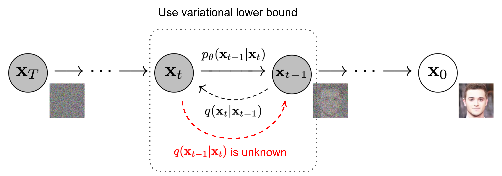

# Diffusion Model

[TOC]

## Architecture

- The inverse process of diffusion process is also a diffusion process.

### Forward Process

During the diffusion process, a small amount of noise $\sigma$ is gradually added to the data $x_0$ step by step $1:T$, finally when $T \to \infty, \bar a_T \to 0$ the $x_T$ completely lost its original information and converges to an Gaussian distribution. This process is usually described by a series of probability distributions $p(x_{t}|x_{t - 1})$ (generally is Gaussian distributions). By the accumulating formula and $\bar a_t$, the distribution of $x_t$ at any time $t$ can be calculated directly from $x_0$, avoiding the step-by-step forward calculation process.

$$
\begin{align*}
q(x_t | x_{t-1}) &= \mathcal{N}(x_t; \sqrt{1-\beta_t} x_{t-1}, \beta_t I)\\
q(x_t | x_0) &= \mathcal{N}(x_t; \sqrt{\bar{\alpha}_t} x_0, (1 - \bar{\alpha}_t) I)\\
\\
x_t &= \sqrt{1 - \beta_t} x_{t-1} + \sqrt{\beta_t} \epsilon\\
&=\sqrt{\bar{\alpha}_{t}} x_{0}+\sqrt{1-\bar{\alpha}_{t}} \epsilon\\
\bar{\alpha}_t &= \prod_{s=1}^t \alpha_s = \prod_{s=1}^t (1 - \beta_s) \\
\end{align*}
$$

- $x_0$: the original data, such as a image.
- $x_t$: the state of the data at time step $t$.
- $\beta_t$: the predefined noise variance at step $t$.
- $\epsilon$: the noise drawn from a standard normal distribution
- $\mathcal{N}$: a Gaussian distribution.
- $\sqrt{\bar{\alpha}_t} x_0$: the mean of $x_t$, representing the decay of the original data $x_0$.
- $(1 - \bar{\alpha}_t)$: the cumulative variance of the noise.

> ***Proof:***
> $$
> \begin{aligned}
> \mathbf{x}_{t} & =\sqrt{\alpha_{t}} \mathbf{x}_{t-1}+\sqrt{1-\alpha_{t}} \epsilon_{t-1} \\
> & =\sqrt{\alpha_{t}}\left(\sqrt{\alpha_{t-1}} \mathbf{x}_{t-2}+\sqrt{1-\alpha_{t-1}} \epsilon_{t-2}\right)+\sqrt{1-\alpha_{t}} \epsilon_{t-1} \\
> & =\sqrt{\alpha_{t} \alpha_{t-1}} \mathbf{x}_{t-2}+\sqrt{{\sqrt{\alpha_{t}-\alpha_{t} \alpha_{t-1}}}^{2}+{\sqrt{1-\alpha_{t}}}^{2}} \bar{\epsilon}_{t-2} \\
> & =\sqrt{\alpha_{t} \alpha_{t-1}} \mathbf{x}_{t-2}+\sqrt{1-\alpha_{t} \alpha_{t-1}} \bar{\epsilon}_{t-2} \\
> & =\cdots \\
> & =\sqrt{\bar{\alpha}_{t}} \mathbf{x}_{0}+\sqrt{1-\bar{\alpha}_{t}} \epsilon
> \end{aligned}
> $$

### Reverse Process

During the reverse diffusion process, the model is dedicated to learning how to reconstruct the original data $x_0$ from pure noise $x_T$ through step by step iteration. Specifically, the model needs to learn a reverse process $q(x_{t - 1}|x_t)$. When the noise step size $\beta_t$ is small enough, the true inverse distribution $q(x_{t-1} | x_t, x_0)$ is approximately Gaussian distribution, makes it possible to predict the mean and variance using a neural network or a parameterized Gaussian distribution $p_\theta(x_{t-1} | x_t)$.

$$
q_\theta(x_{t-1}|x_t) = \mathcal{N}(x_{t-1}; \mu_\theta(x_t, t), \Sigma_\theta(x_t, t))
$$

- $\mu_\theta(x_t, t)$; the mean of the model predictions.

- $\Sigma_\theta(x_t, t)$: the variance of the model predictions.

#### Variational lower bounding

The goal of the inverse process is to recover the data $x_0$ from the noise $x_T$, and its correctness is ensured by variational inference (VI). 
$$
\text{ELBO} = \mathbb{E}_{q} \left[ \log p_\theta(x_0 | x_1) \right] - \sum_{t=2}^T \mathbb{E}_{q(x_t | x_0)} D_{KL}\left( q(x_{t-1} | x_t, x_0) \| p_\theta(x_{t-1} | x_t) \right).
$$

$$
\begin{align*}
q(x_{t-1} | x_t, x_0) &= \mathcal{N}\left( x_{t-1}; \tilde{\mu}_t(x_t, x_0), \tilde{\beta}_t I \right)\\
\tilde{\mu}_t(x_t, x_0) &= \frac{\sqrt{\alpha_t} (1 - \bar{\alpha}_{t-1})}{1 - \bar{\alpha}_t} x_t + \frac{\sqrt{\bar{\alpha}_{t-1}} \beta_t}{1 - \bar{\alpha}_t} x_0\\
\tilde{\beta}_t &= \frac{1 - \bar{\alpha}_{t-1}}{1 - \bar{\alpha}_t} \beta_t
\end{align*}
$$

#### Train & Loss Function

During the training phase of the model, in order to approximate the distribution of the reverse process, we usually adopt the method of the Evidence Lower Bound. The training goal of the diffusion model is to maximize the data likelihood, which is usually optimized by the variational lower bound (ELBO). The loss function consists of the following two parts.

1. Reconstruction loss $\log p_\theta(x_0 | x_1)$, which measures the difference between generated data and real data.
2. KL divergence term, which measures the difference between the inverse distribution predicted by the model and the real inverse distribution.

$$
\begin{align*}
\mathcal{L} &= \mathbb{E}_{q(x_{1:T} | x_0)} \left( \log p_\theta(x_0 | x_1) - \sum_{t=2}^T D_{KL}(q(x_{t-1} | x_t, x_0) \| p_\theta(x_{t-1} | x_t)) \right)
\end{align*}
$$

In actual training, the loss function can be simplified to the mean square error (MSE) of the noise prediction. At the same time, the model directly predicts the noise $\epsilon$ instead of the mean $\mu_\theta$, rather than complex distribution parameters, greatly reducing the difficulty of learning.

$$
\mathcal{L}_{\text{simple}} = \mathbb{E}_{t, x_0, \epsilon\sim \mathcal{N}(0,I)} \left( \| \epsilon - \epsilon_\theta(x_t, t) \|^2 \right)
$$

- $D_{KL}$ is the KL divergence, which measures the difference between two distributions.
- $q(x_{t-1} | x_t, x_0)$ is the true inverse distribution.
- $p_\theta(x_{t-1} | x_t)$ is the inverse distribution predicted by the model.
- $\epsilon$ is the noise added in the forward pass.
- $\epsilon_\theta(x_t, t)$ is the noise predicted by the model.

#### Minimizing KL divergence

模型通过最小化 $D_{KL}(q(x_{t-1} | x_t, x_0) \| p_\theta(x_{t-1} | x_t))$ 来逼近真实逆向分布。  具体地，假设 $p_\theta(x_{t-1} | x_t) = \mathcal{N}(x_{t-1}; \mu_\theta(x_t, t), \Sigma_\theta(x_t, t))$，则KL散度的最小化等价于优化以下目标：
$$
\mathbb{E}_{q} \left[ \frac{1}{2\Sigma_\theta^2} \| \tilde{\mu}_t - \mu_\theta \|^2 \right] + \text{常数项}.
$$
通过参数重整化（将 $x_t$ 表示为 $x_0$ 和噪声 $\epsilon$ 的线性组合），可将均值预测转化为噪声预测：
$$
\mu_\theta(x_t, t) = \frac{1}{\sqrt{\alpha_t}} \left( x_t - \frac{\beta_t}{\sqrt{1 - \bar{\alpha}_t}} \epsilon_\theta(x_t, t) \right).
$$
最终损失函数简化为对噪声的均方误差：
$$
\mathcal{L}_{\text{simple}} = \mathbb{E}_{t, x_0, \epsilon} \left[ \| \epsilon - \epsilon_\theta(x_t, t) \|^2 \right].
$$

#### 正确性的严格保证

- 当 $\beta_t$ 足够小时，逆向过程的每一步 $q(x_{t-1} | x_t)$ 近似为高斯分布（由前向过程的局部线性性保证）。  
- 因此，用高斯分布 $p_\theta(x_{t-1} | x_t)$ 建模是合理的。
- 前向过程是马尔可夫链，逆向过程也被建模为马尔可夫链。  
- 通过优化ELBO，逆向链的参数 $\theta$ 被学习以匹配前向链的逆过程。
- 变分下界（ELBO）的最大化等价于最小化 $D_{KL}(q(x_{1:T}|x_0) \| p_\theta(x_{0:T}))$，迫使模型分布 $p_\theta$ 逼近真实数据分布。  
- 由于前向过程的 $q(x_T)$ 是标准高斯分布，逆向过程的初始采样点 $x_T \sim \mathcal{N}(0, I)$ 确保了生成过程的起点正确。

在概率模型和统计学中，变分下界（Variational Lower Bound）是指一个由变分推断（Variational Inference）方法用来近似复杂概率模型中的后验分布的技术。这个方法通常用在贝叶斯推断中，特别是当后验分布难以直接计算时。在变分推断中，我们使用一个简单的分布（变分分布）来近似我们感兴趣的复杂后验分布。变分下界就是对模型证据（或边际似然）的一个下界，它是由变分分布定义的。具体来说，考虑一个有参数$\theta$的模型，和观测数据$x$，我们感兴趣的是后验分布$p(\theta|x)$。变分推断通过引入一个简单的变分分布$q_\phi(\theta)$来近似$p(\theta|x)$，这里$\phi$是变分分布的参数。变分下界（ELBO）是由以下不等式给出的：

$$
\log p(x) \geq \mathbb{E}_{q_\phi(\theta)}[\log p(x|\theta)] - \text{KL}(q_\phi(\theta) || p(\theta)) = \text{ELBO}
$$

这里，$\log p(x)$是对数证据（也称为边际似然），$\mathbb{E}_{q_\phi(\theta)}[\log p(x|\theta)]$是在变分分布下的条件对数似然的期望，而$\text{KL}(q_\phi(\theta) || p(\theta))$是变分分布和先验分布之间的Kullback-Leibler散度。ELBO是对数证据的一个下界，因此通过最大化ELBO，我们可以间接地最大化对数证据。在优化过程中，我们不是直接计算对数证据，而是优化ELBO，这是因为对数证据往往难以直接计算。通过调整变分分布的参数$\phi$，我们可以使变分分布尽可能接近真实的后验分布，从而使ELBO最大化。在扩散模型的背景下，变分下界用于训练神经网络来近似逆扩散过程，这样可以从噪声数据中重构出有意义的样本。通过最大化变分下界，我们可以改善模型对数据生成过程的学习。

### Sampling

When generating data, we start with the noise $x_T$ and gradually apply the reverse process to generate $x_0$. Each step generates $x_{t-1}$ from $x_t$ by subtracting the predicted noise $\epsilon_\theta$ and adding a small amount of random noise as the random perturbation, which balances the accuracy and diversity of the generated results.

**Noise Schedule**: Control the smoothness of the generation process by adjusting $\beta_t$ and $\sigma_t$. For example, using a cosine schedule can avoid overly sharp edges.
$$
x_{t-1} = \frac{1}{\sqrt{\alpha_t}} \left( x_t - \frac{\beta_t}{\sqrt{1 - \bar{\alpha}_t}} \epsilon_\theta(x_t, t) \right) + \sigma_t z
$$

- $z \sim \mathcal{N}(0, I)$ is random noise.
- $\sigma_t$ is the standard deviation of the noise.

