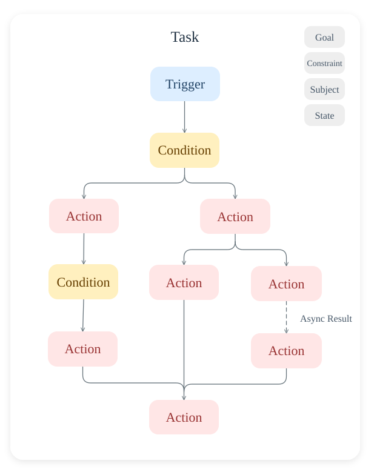
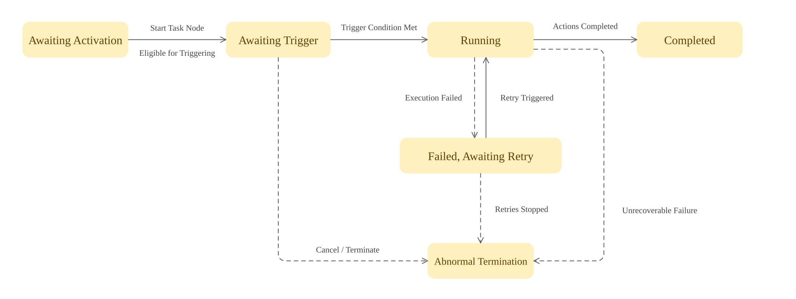
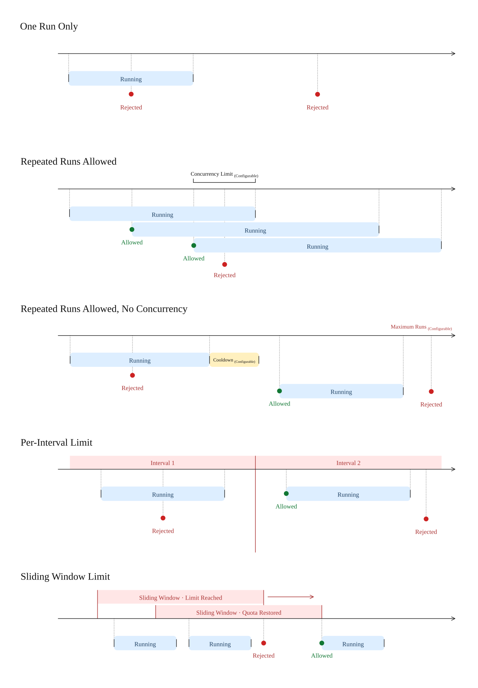
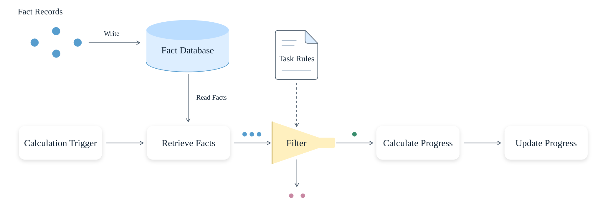
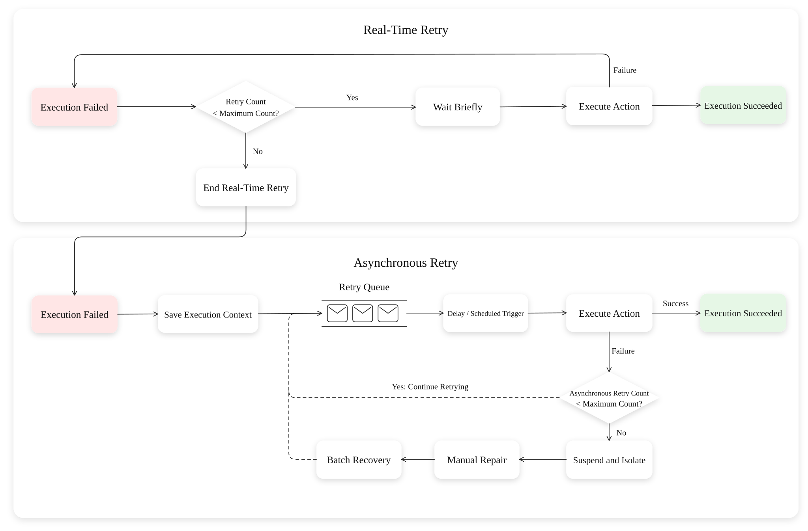
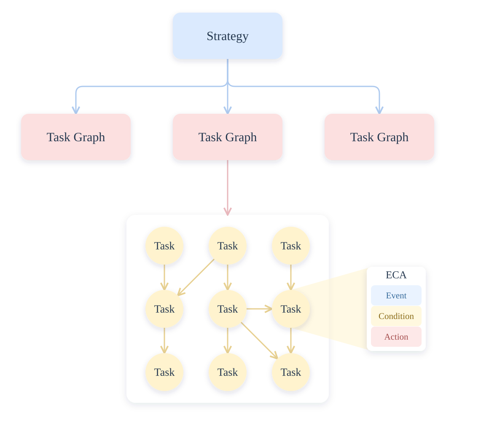
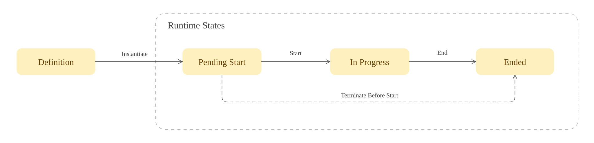
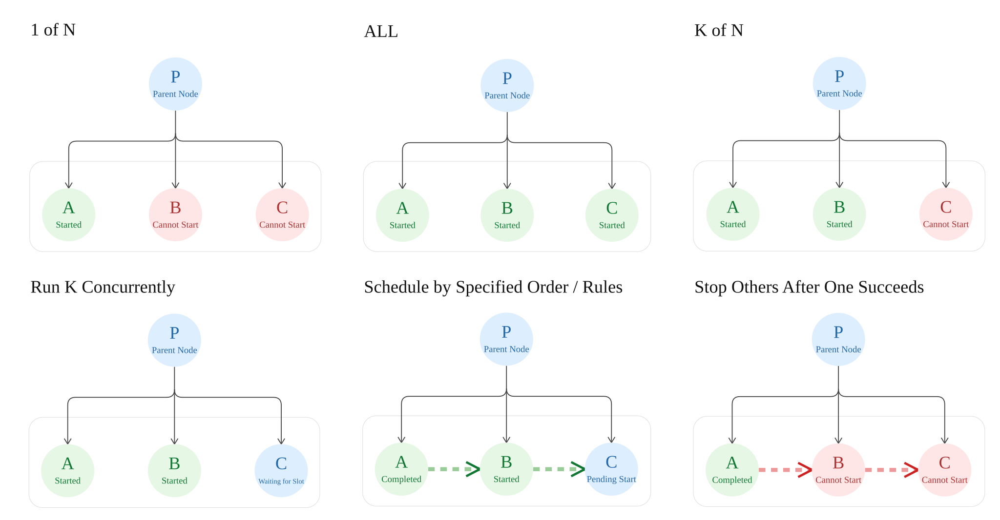
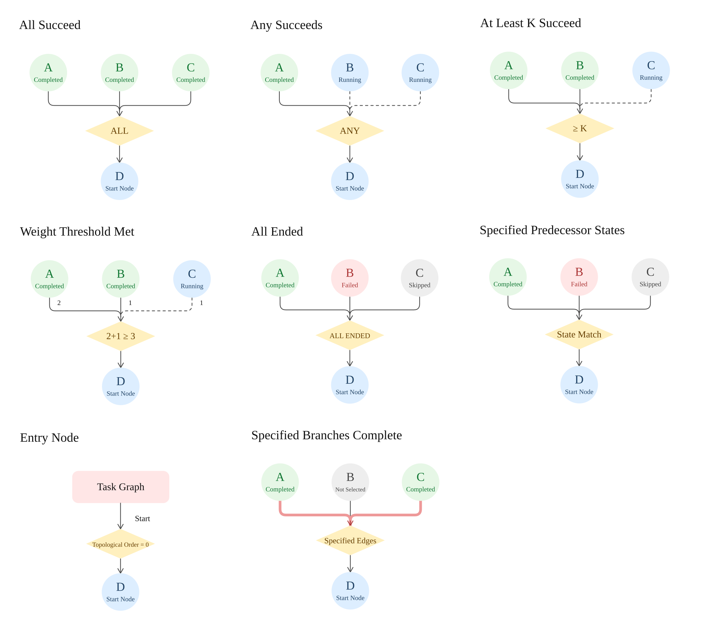
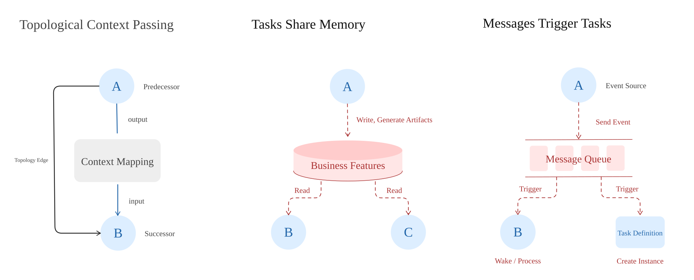

# Task

## What Is a Task?

**Task:** A task is a unit of work organized around a clearly defined objective, carried out by an accountable entity under agreed-upon rules and constraints, with determinable completion or termination criteria. Once activated, a task embodies an ongoing responsibility and commitment to act. This responsibility can be progressively discharged through the performance of required actions until the objective is achieved or the task is terminated in accordance with the agreed rules.

### Examples

A **Marketing Task** is an operational mechanism through which the platform incentivizes users to perform specific behaviors by offering rewards upon task completion. Based on its operational objectives, the platform establishes conditional **commitments** to provide benefits, explicitly informing users that completing specified **behaviors** within a defined timeframe, execution path, and set of rules will entitle them to corresponding **benefits**. Upon being presented with the commitment, users may choose whether to **participate**. Once accepted, the system continuously tracks their behavioral **progress** and evaluates objective achievement according to predefined rules. Upon achievement, the platform fulfills its commitment within budgetary and risk control constraints and may guide users toward subsequent tasks or new participation opportunities, forming a continuous incentive loop.

> **Commitment Presentation → User Acceptance → Behavior Completion → Progress Measurement → Benefit Fulfillment**

An **Enforcement Task** is a governance mechanism that imposes restrictions on the rights, privileges, and conduct of a specific entity in accordance with applicable governing rules, and modifies or terminates such restrictions in light of subsequent factual findings. Based on findings of fact and the determination of liability, the platform determines the grounds for enforcement, applicable sanctions, and adjudicative determinations, translating adjudicative determinations into enforceable restrictions. Once the enforcement action becomes effective, the system continuously monitors compliance with the enforcement action, remedial actions, and appellate determinations:

- When remediation requirements are satisfied or the enforcement period expires, restrictions are lifted and entitlements are restored in accordance with applicable rules.
- When an appeal is upheld or the original decision is corrected, the original enforcement measures are revoked or modified. Reversible impacts are rolled back, while irreversible impacts are addressed through compensation.
- When requirements remain unmet, enforcement measures are maintained or escalated according to predefined rules.

## Single Task Node

A **Task** is modeled as a set of executable activities organized around a clearly defined objective. It is defined by rules governing its objectives, constraints, and applicable entities. A task is triggered by a **Trigger**, evaluated through **Conditions**, and subsequently directed to the corresponding **Action** execution path.

- **Trigger:** Defines when a task is triggered. Supported mechanisms include scheduled triggers, asynchronous event triggers, and synchronous invocations.
- **Condition:** Defines the prerequisites and constraints that must be satisfied before task execution, such as whether the required progress threshold has been reached or whether specific expected behaviors have been completed.
- **Action:** Describes the specific business operations to be performed during task execution, such as reward issuance, account suspension or reinstatement, user outreach, and phone calls.

### Lifecycle

#### Definition vs. Runtime

A generic task model should distinguish between two levels: the task definition and the task instance, representing the normative structure of a task and its concrete occurrence, respectively.

1. **Definition**: A task definition is a normative specification of the rules governing a task. It defines the task objective, input requirements, applicability conditions, completion criteria, and termination rules.
2. **Runtime**: A task instance is a concrete runtime record created when a participant engages in a task. It binds abstract rules to specific business entities and records the participant's execution progress and processing results.

#### State Machine

The state machine governs the lifecycle of a task instance. Once a task is bound to a specific business entity and instantiated, its corresponding state machine is initialized. The task states are defined as follows:

- **Not Started**: The node has not been activated and cannot respond to triggers.
- **Awaiting Trigger**: The node has been activated and can listen for and respond to triggers.
- **Executing**: The trigger requirements have been satisfied, and the node's actions are being executed.
- **Failed, Awaiting Retry**: The current execution attempt has failed but is eligible for retry. The node is awaiting the next scheduled retry.
- **Completed**: All required actions have satisfied the completion criteria, and their execution results have been persisted. Successor tasks may now be activated.
- **Abnormally Terminated**: The node has terminated due to cancellation, explicit termination, unrecoverable failure, or retry exhaustion. No further automatic execution will occur.

### Instantiation

Instantiation is the process of creating an independent task instance for a specific participant and business scenario based on a task definition, subject to the applicable participation constraints. The process supports customization of instance attributes based on participant characteristics and business context. It involves several complex operations, including generating instance identifiers, binding participant identities and business context, establishing the idempotency boundary for the current participation, and continuously tracking the instance.

#### Instantiation Idempotency Key

> Instantiation Dimension = Event Attribute A + Event Attribute B + ...
>
> Instance Idempotency Key = Instantiation Dimension + Definition ID + Participation Sequence (Turn)

1. **Instantiation Idempotency**. For the same transition request from the same user, regardless of how many times the system receives the request — for example, due to network retransmissions or repeated user interactions — the system must produce exactly one correct logical transition effect, such as a state update, points accrual, or reward issuance, without causing duplicate issuance or inconsistent states.

2. **Instantiation Dimension**. It is designed to ensure the idempotency of activity transitions. It consists of a combination of event attributes:

   > Event Attribute A + Event Attribute B + ...

   These event attributes are typically parameters carried by the triggering event. Depending on the specific product and business scenario, appropriate attributes may be selected as the basis for idempotency. Based on the selected transition key, the Activity Instance ID can be constructed from the combination of the Transition Key, Activity ID, and participation round.

#### Repeat Participation Constraints

Repeat participation constraints are configured at the task definition level. Whether the same user can participate in the same task again is determined by the participation policy defined in the task definition. The following participation modes are supported:

1. **Unlimited Participation**: Repeated participation is permitted, and multiple active instances may coexist. An optional maximum number of participation rounds may be configured.
2. **Repeatable, Non-Concurrent Participation**: Repeated participation is permitted, but at most one non-terminal instance may exist at any given time. A new instance can only be created after the existing instance has terminated. An optional maximum number of participation rounds may be configured.
3. **One-Time Participation**: Only one task instance may be created. Regardless of how that instance terminates, subsequent participation is not permitted.
4. **Once per Time Window**: A set of time windows is configured. Participation is permitted at most once within each window. A participant becomes eligible to participate again upon entering another window.

#### Task Definition Snapshot

As a general principle, an effective task commitment should not be arbitrarily weakened by subsequent changes to the platform's rules. Therefore, when a Task Instance is created, a snapshot of the Task Definition at the time of instantiation should be persisted to isolate the instance from subsequent definition changes. All subsequent progress evaluations and commitment fulfillment should be based on this snapshot. When modifying a Task Definition, two scenarios must be distinguished:

1. **Changes Affecting New Instances Only:** Newly created Task Instances adopt the updated rules, while existing instances continue to operate under their original Task Definition snapshots.
2. **Changes Affecting Existing Instances:** Updated rules also apply to designated existing Task Instances. These instances are notified to update their definition snapshots and adopt the new rules.

Under exceptional circumstances, such as fraud, risk events, inventory depletion, or system failures, existing Task Instances may be adjusted or terminated. However, the handling procedures must be explicitly defined, and all subsequent remediation must be carried out in accordance with pre-established rules.

#### Instantiation Entry Point: Candidate Retrieval and Filtering

When creating a task for a specific entity, the initiating party submits a request through the instantiation entry point, specifying the target entity and the relevant business context. Upon receiving the entity identifier and contextual information, the instantiation entry point matches applicable Task Definitions and validates their creation criteria. The system retrieves candidate Task Definitions based on the entity and its current context, filters candidates that satisfy the instantiation conditions, and creates Task Instances upon successful validation.

Retrieval and filtering criteria include the following:

| Filter Category          | Filtering Criteria                                           |
| ------------------------ | ------------------------------------------------------------ |
| **Temporal and Spatial** | Time ranges and geographic regions. Supports all available regions, specified time periods, and designated dates. |
| **Entity**               | Entity type and current status. Supports targeting specific entity segments. |
| **Scenario**             | Originating entry point, event type, and business context. Validates whether the request originates from a scenario supported by the Task Definition. |
| **Rules**                | Validates whether the entity and context satisfy the prerequisites and fine-grained conditions specified in the Task Definition. |
| **Instance Constraints** | Prevents duplicate instantiation and enforces concurrency restrictions. |

### Task Progress

When a task consists of a set of outstanding activities organized around a clearly defined objective, task progress is used to describe what has already been accomplished, what remains outstanding, and what needs to be done next.

#### Behavior Recording and Progress Calculation

Progress calculation is an area of task management that is particularly susceptible to disputes. The system should not merely store a numerical progress value. It should also retain the relevant behavior records and calculation rationale so that task outcomes can be explained during progress inquiries, result verification, and audit tracing.

Behavior records should remain as factual and objective as possible, avoiding premature association with any specific task. A single behavior or outcome may be relevant to multiple tasks. The system should first record the underlying facts and subsequently calculate progress independently according to the rules of each applicable task. When a previously credited outcome is revoked or the underlying facts are corrected, the system should adjust task progress according to the applicable rules and retain both the pre-adjustment and post-adjustment results, together with the reasons for the adjustment. This end-to-end process is typically supported by a Rule Engine and feature data. Progress calculation generally consists of four steps:

1. Record underlying facts.
2. Filter eligible records.
3. Calculate progress.
4. Generate explainable results.

#### Progress Logs

Progress calculation logs should contain at least the information listed below.

| Information                        | Description                                                  |
| ---------------------------------- | ------------------------------------------------------------ |
| **Objective and Current Progress** | The current level of task completion and the remaining gap to the objective. |
| **Credited Records**               | Behaviors and events that have been counted toward progress, together with their individual contributions. |
| **Excluded Records**               | Behaviors and events that have not been counted toward progress, together with the specific reasons for exclusion. |
| **Time Window**                    | The effective time range of the task.                        |
| **Deduplication Rules**            | Whether the same behavior or event may be counted multiple times and how duplicate records are identified. |
| **Node Attribution**               | The task node to which a behavior or outcome is attributed, and whether it may be counted across multiple nodes. |
| **Rule Reference**                 | The rules and rule versions applied in the current calculation. |

### Action Execution

Action execution is the process of performing operations in accordance with previously established commitments once the task conditions are satisfied. Conceptually, it consists of three stages: **Commitment, Eligibility Verification, and Fulfillment**.

| Stage           | Description                                                  |
| --------------- | ------------------------------------------------------------ |
| **Commitment**  | The task presents and communicates the expected commitment before the entity participates. |
| **Eligibility** | Upon receiving a triggering event, the system verifies whether the eligibility criteria for Action execution have been satisfied. |
| **Fulfillment** | The platform performs the actual business operations to fulfill the established commitment. |

#### Action Group Orchestration

Multiple business-related actions are organized into an Action Group to centrally manage their execution order, dependencies, and execution results. An action group serves as an execution unit within a workflow. Its orchestration capabilities should address the following aspects:

1. **Execution Topology**: Sequential, parallel, and hybrid execution patterns are supported. Sequential actions are executed in order and are suitable for scenarios involving dependencies between actions. Parallel actions are executed concurrently and are suitable for mutually independent operations. Complex dependencies are represented using a Directed Acyclic Graph (DAG), where an action becomes eligible for execution only after its prerequisite dependencies have been satisfied.
2. **Data Communication**: Action inputs can be resolved from the workflow context, static configuration, and outputs of preceding actions. Concurrent execution must also prevent actions from overwriting one another's data.
3. **Synchronous and Asynchronous Execution**:
   - Synchronous Execution: The invocation directly returns the action's execution result.
   - Asynchronous Execution: The action is first submitted for execution, and its final result is subsequently obtained through a callback or status query.
   - Asynchronous ASK: The action initially returns information and suspends further execution until the user or caller provides confirmation or performs an operation that determines whether execution should continue.
4. **Condition–Action Composition**: In addition to task-level conditions that determine whether actions should be executed, actions themselves may support conditional branching, allowing specific action branches to be executed according to business outcomes.

`action-group-execution-modes`

#### Action Group Transactional Consistency: Local Transaction Table

For an action group managed within a single logical transaction boundary, a local transaction table is used to persist execution intent and action results, allowing task state transitions to be managed at the action group level. A task node may be marked as completed only after all required actions within the group have succeeded. In the event of partial failure, the execution progress is preserved so that unfinished actions can be resumed. The local transaction table also serves as the task node instance table. In other words, the task node instance itself serves as the persistent record for local transactional consistency management.

`action-group-local-transaction`

#### Action Retry

Action retries are managed by an independent retry scheduler external to the main workflow execution path. The retry mechanism can be divided into Immediate Retry and Asynchronous Retry, which complement each other.

1. **Immediate Retry**. A limited number of short-interval retries are performed within the current execution attempt to recover from transient failures, such as connection failures or temporary service unavailability.

   Immediate retries are constrained by the overall timeout budget of the current request to avoid prolonged blocking.

2. **Asynchronous Retry**. When immediate retries fail or a longer waiting period is required, the retry plan is persisted. A background scheduler records the execution context and publishes retry requests to a dedicated retry message queue (MQ). Subsequent retries are driven by the message queue or a timer-based scheduling mechanism.

The retry mechanism should address the following considerations:

1. **Retry Policy**: Distinguish between retryable and non-retryable errors. A downstream error does not necessarily mean that the action has failed; the action may already have succeeded. Therefore, retry operations must be idempotent. Retry policies should support action-level configuration of retry limits, retry intervals, maximum retry intervals, and retry deadlines. Retry amplification caused by retries across multiple system layers must also be prevented.
2. **Context Persistence**: Asynchronous retries must operate on an explicitly persisted context snapshot to prevent inconsistent execution behavior caused by changes to configuration or workflow versions.
3. **Manual Intervention as a Fallback**: Upon terminal failure, the action should be routed to alerting, manual intervention, or compensation procedures according to the applicable business policy. Retries are intended to re-execute the original action, whereas compensation addresses business effects that have already occurred. These mechanisms should be designed independently.

#### Action Callback Management

### Reverse Workflow

A Reverse Workflow is the process of revoking, restoring, and correcting the execution outcomes of an original task.

#### Reversibility of Action Effects

When a task executes an Action, it changes the state of business entities and their external environment. When the task is revoked, these existing impacts must be addressed. The appropriate handling mechanism depends on whether the impacts of the Action are reversible. If the original impact can be undone, a rollback should be performed. If it cannot be directly undone, compensation should be carried out through new Actions. A single Action may produce both reversible and irreversible impacts, which must be handled separately.

**Reversible Impacts: Rollback**

Rollback reverses the impacts produced by the original Action through corresponding inverse operations, restoring the business entity to a valid state in which it is no longer subject to the effects of that Action.

**Irreversible Impacts: Compensation**

When the impact of an original Action cannot be directly undone, compensation introduces new business operations to correct the resulting outcome or compensate for losses. Compensation cannot restore historical facts to a state in which the original Action never occurred. Instead, it ensures that subsequent outcomes conform to the applicable business commitments and agreements.

## Task Graph

A single task node can independently handle triggering, condition evaluation, and execution. However, complex business processes typically require collaboration among multiple nodes: some tasks must wait for their predecessors to complete, some can execute concurrently, and others require conditional branching or result aggregation. Independent task nodes alone cannot fully express these collaborative relationships, nor can they establish a unified boundary for a single execution round. Therefore, a Task Graph is introduced to organize related task nodes, their dependencies, and their collaboration rules into a cohesive structure.

1. **Task**: An individual task node is responsible for a specific unit of work. It receives triggering events through a Trigger, determines whether execution should proceed through Conditions, and performs concrete operations through Actions.
2. **Task Graph**: When multiple nodes collectively fulfill a business process, their dependencies, branching, convergence, and collaboration constraints must be explicitly defined, forming a Task Graph. A Task Graph consists of Tasks as nodes and directed edges representing control dependencies between predecessor and successor nodes.
3. **Strategy**: A Strategy organizes multiple Task Graphs at a higher level, providing centralized orchestration, a unified structural view, and a common management entry point for task graphs within the same business scenario. It primarily serves as a logical container and does not necessarily require an independently persisted entity. Related task graphs may simply be associated through a shared, convention-based identifier.

### Lifecycle

#### Task Graph Instance State Machine

A **Task Graph Instance** serves as the aggregate coordinator for all task node instances within its scope. Since many execution capabilities are already handled in a distributed manner at the node level, the task graph instance itself does not require extensive responsibilities. Its primary responsibilities include:

1. Execution Identity: Uniquely identifies a task graph execution and provides a common scope under which related task node instances are grouped.
2. Instantiation Constraints: Enforces and records instantiation constraints at the graph level, including runtime idempotency information, participant identity, business associations, and the version of the task graph definition snapshot.
3. Lifecycle Convergence: Aggregates the terminal states of task nodes. When all nodes have reached terminal states and no pending successor activations remain, the task graph instance automatically transitions to the Terminated state.
4. Graph-Level Centralized Scheduling:
   - Graph Startup: Initiates the activation of all entry nodes (Head Tasks).
   - Centralized Termination: Stops all task nodes within the graph.
5. Shared Information Storage: Persists identities, inputs, context, or references shared across the current graph execution.

Given its relatively limited responsibilities, the Task Graph Instance has a comparatively simple state machine:

- **Definition**: The normative definition of the task graph before it is bound to an execution participant and instantiated. Each participation in the task graph creates a corresponding runtime instance.
- **Not Started**: The runtime instance has been created but has not yet started due to scheduling or other prerequisite conditions.
- **In Progress**: The task graph has started. Upon startup, all task nodes with a topological level of zero are automatically activated.
- **Terminated**: The task graph has ceased progressing. When all internal nodes have either completed or become unable to proceed, the task graph automatically transitions to its terminal state.

#### Graph Node Instantiation

Two approaches to Task Node instantiation are considered:

| Approach                                           | Instantiation and Persistence Timing                         | Advantages                                                   | Disadvantages                                                |
| -------------------------------------------------- | ------------------------------------------------------------ | ------------------------------------------------------------ | ------------------------------------------------------------ |
| **Eager Instantiation (Full Instantiation)**       | All Tasks are instantiated and persisted synchronously when the Task Graph Instance is created. | Simplifies runtime execution logic, as subsequent operations only require state updates. Provides a complete view of the task structure directly from instance data. | High upfront overhead, increased initialization latency, and greater storage write pressure. May generate redundant instances that are never executed. Workflows that dynamically generate nodes based on runtime conditions require additional compensating handling. |
| **Lazy Instantiation (Progressive Instantiation)** | Tasks are instantiated and persisted only when they are activated as the workflow progresses. | Lower storage and computational overhead. Better suited to workflows in which successor nodes are determined by runtime conditions. Provides greater flexibility. | More complex runtime control. Future Tasks cannot be directly observed from instance data and typically need to be inferred from the workflow definition. |

### Inter-Task Transitions and Communication

Collaboration between Tasks consists of two aspects: Control Flow and Data Communication. Control flow determines when a task becomes eligible for activation. Data communication is responsible for transferring inputs, sharing facts, and propagating external events between tasks.

#### Inter-Task Control Flow

Inter-task control flow addresses two fundamental questions:

1. Which nodes are eligible for activation?
2. Can eligible nodes proceed concurrently?

##### Predecessor–Successor Topological Relationships

Whether a task node can be activated is determined by its set of predecessor nodes and the conditions satisfied by those predecessors. Directed edges define the scope of dependencies, while activation rules specify how the states and execution results of these dependencies are aggregated and evaluated. The current node may adopt the following activation rules:

##### Intra-Group Control Constraints for Peer and Sibling Tasks

Control constraints may also exist among tasks at the same topological level or tasks sharing a common predecessor, allowing the activation and execution of a group of tasks to be coordinated. Group-level constraints determine whether nodes that are individually eligible for activation may proceed together. These constraints apply to a collection of task nodes and specify which nodes may proceed concurrently, which nodes must be mutually exclusive, and whether execution ordering, priorities, or concurrency limits apply.

#### Inter-Task Data Communication

##### Topology-Based Context Propagation

Topology-based context propagation refers to mapping the outputs of predecessor task nodes to the inputs of successor task nodes along their topological relationships.

This approach is suitable for scenarios where data dependencies align with control dependencies.

##### Shared Task Memory

Shared task memory is an explicitly readable and writable shared data space. Its logical meaning is not restricted to in-process memory; it may be implemented using databases, feature stores, caches, or other storage mechanisms. It is suitable for sharing facts across nodes, persisting intermediate results, and maintaining collaborative state. Writing to shared memory only indicates that data has changed. It does not implicitly activate or wake up other tasks.

##### Message-Based Task Triggering

Tasks communicate by publishing messages of specified event types, triggering the creation, activation, or event processing of individual tasks or collections of tasks. This approach is suitable for collaboration between nodes without direct topological relationships, external callbacks, and asynchronous notifications.

### Task Graph Execution Flow

1. **Event Triggering and Task Filtering**. Receive an event message and retrieve the set of active task nodes that can be triggered by the event.

2. **Progress Calculation and Completion Evaluation**. Invoke the Rule Engine for each task node to calculate task progress. If the task has not met its completion conditions, proceed to the next task. If the completion conditions have been met, advance the workflow toward successor tasks.

3. **Action Execution**. Retrieve the Actions configured for the current task node, resolve their execution parameters, and execute them sequentially or concurrently according to their configuration. Persist the execution status of each Action independently, including successful execution, failure, and asynchronous waiting. Retryable failures transition the task node to Failed, Awaiting Retry, while unrecoverable failures transition it to Abnormally Terminated.

   Once all required Actions have satisfied the completion criteria, the task node transitions to Completed.

4. **Successor Activation and Workflow Advancement**. Upon task completion, recursively  iterate through its successor tasks and evaluate whether each successor currently satisfies its activation criteria. If a successor is not eligible for activation, temporarily skip it. If its activation criteria are satisfied, transition it to an active state. If the successor task's triggering conditions can be satisfied immediately, execute it immediately.

5. **End of the Current Execution Round**. The current execution round concludes once all Head Tasks and their eligible downstream execution chains have been processed.
