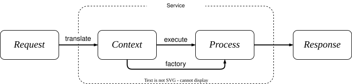

# Service design
[TOC]

## Context

- **Request**: The system receives input data from the user. This input could be a query, command, or data that needs to be processed.
- **Context**: The input is first translated into the internal language of the service. This internal language is used to ensure that the input is standardized and can be understood and processed consistently across various system components.
- **Process**: Based on the translated input, the system determines the appropriate process or workflow to handle the request. Analyze Input Type, Select Process, Invoke Process, Process Execution.
- **Respond**: After the process is completed, the system generates a response based on the results.




## API & SPI

- **Application Programming Interface**: API 是一组定义软件应用程序之间交互的接口。这些接口提供了调用方法、传递数据和处理响应的规则和约定，使得不同的软件组件或系统可以互操作。
- **Service Provider Interface**: SPI 是一种提供框架或库的扩展机制的接口，使得第三方可以提供其自己的实现。这种接口通常是由框架或库定义的，而具体实现则由开发者提供。

## Status machine

Go 计算服务 govaluate: [Knetic/govaluate: Arbitrary expression evaluation for golang (github.com)](https://github.com/Knetic/govaluate)


阿里发布三原则: 可灰度. 可监控. 可回滚.


## Object Design

### Attributes

- Base
  - ID
  - Name
  - Type & Status

- Time
- Space
  - Country, City, County, Language
- Relationship
  - parents & children
  - tempalate & instance
- Rules

## Design Patterns

## Singleton

Singletons are used to ensure that a class can only have one instance and provide a global access point to that instance. This is useful in many situations, such as managing shared resources, configuration information, database connections, etc.

- **Private Constructor**: The constructor of a singleton class should be private to prevent other classes from instantiating the class directly.
- **Private Static Instance**: A singleton class should contain a private static member variable that holds the only instance.
- **Static public method to get instance**: Provides a public static method for getting an instance of the class.
- **Create and Initialization Instance**: There are different methods depending on the time of instance creation
  - **Eager Initialization**
  - **Lazy Initialization**
  - **Double-Checked Locking**


### Eager Initialization

Instances are created when the class is loaded, whether needed or not. This approach is simple and straightforward, but may waste resources, because the instance is created when the class is loaded.

```java
public class Singleton {
    private static final Singleton instance = new Singleton();
    
    private Singleton() {
        // Private constructor to prevent external instantiation
    }
    
    public static Singleton getInstance() {
        return instance;
    }
}
```

### Lazy Initialization

Instances are created only when needed, avoiding unnecessary waste of resources. But you need to consider thread safety issues, you can use the synchronized keyword to ensure thread safety.

```java
public class Singleton {
    private static Singleton instance;
    
    private Singleton() {
        // Private constructor to prevent external instantiation
    }
    
    public static synchronized Singleton getInstance() {
        if (instance == null) {
            instance = new Singleton();
        }
        return instance;
    }
}
```

### Double-Checked Locking

Reduce the use of synchronized and improve performance by double checking. This method needs to pay attention to the problem of instruction reordering, which can be solved by the volatile keyword.

```java
public class Singleton {
    private static volatile Singleton instance;
    
    private Singleton() {
        // Private constructor to prevent external instantiation
    }
    
    public static Singleton getInstance() {
        if (instance == null) {
            synchronized (Singleton.class) {
                if (instance == null) {
                    instance = new Singleton();
                }
            }
        }
        return instance;
    }
}
```

[domain-driven_design](./domain-driven_design.md)


## High Performance & High Concurrency & High Availability

[High Availability](./high_availability.md)

易扩展
