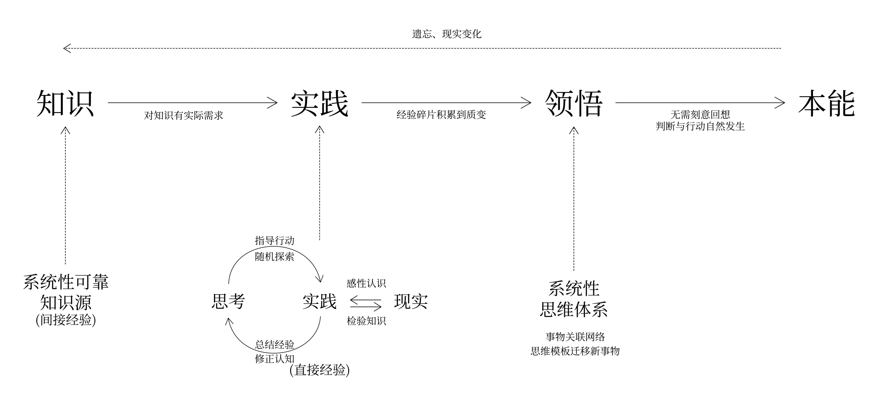

Knowledge ≪ Practice ≪ Realization ≪ Instinct

1. First, there is an information source: you know that such a thing exists.
2. You can genuinely put it into practice and discover many unspoken undercurrents and experience passed down by word of mouth.
3. Once all the pieces of the thinking puzzle are completely assembled, in an instant you piece together the entire thought system from scattered fragments of experience.
4. The thought system is called upon day after day and becomes a matter-of-course instinctive response. Without deliberate recall, judgment and action occur naturally.

